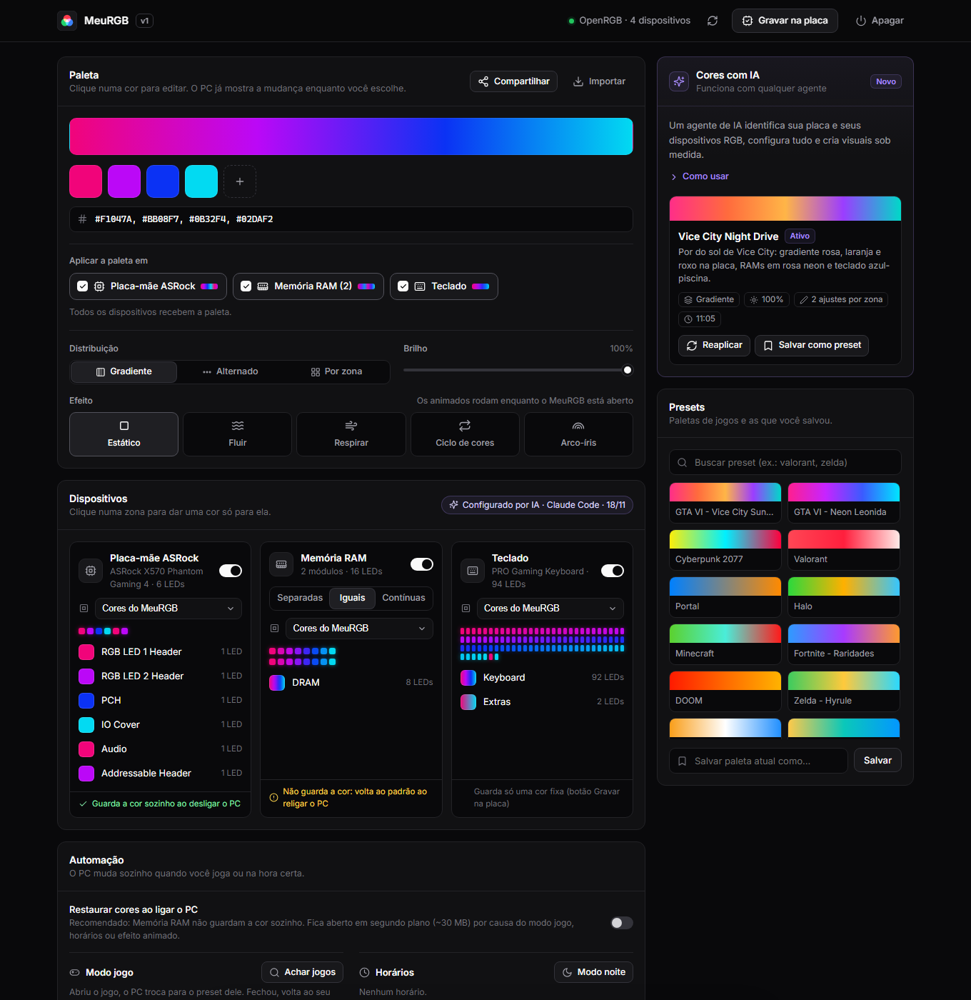

<p align="center">
  
</p>

<h1 align="center">MeuRGB</h1>

<p align="center">
  <b>O RGB do seu PC, configurado por IA.</b><br>
  <sub><i>Your PC's RGB, set up by AI.</i></sub>
</p>

<p align="center">
  
  
  
  
  
</p>

<p align="center">
  <a href="#português">Português</a> · <a href="#english">English</a>
</p>

<p align="center">
  
</p>

> [!NOTE]
> **Versão 1 (V1).** Primeira versão pública: já funciona no dia a dia, mas ainda vai mudar bastante.
> **Version 1 (V1).** First public release: works day to day, but will still change a lot.

---

## Português

### Feito para a IA fazer o trabalho

Cada PC tem uma placa-mãe, umas memórias e uns periféricos diferentes. Em vez de você caçar configuração, **um agente de IA faz isso por você**: Claude Code, Codex, Gemini CLI, Cursor, Copilot ou qualquer agente que rode comandos no seu PC.


| Você pede | O agente faz |
|---|---|
| *Cole o prompt pronto do app (Cores com IA → Como usar).* | Detecta placa-mãe, BIOS, RAMs, GPU, periféricos e os efeitos que cada chip suporta. Faz as perguntas uma de cada vez (estilo, dispositivos, efeitos, modo jogo, horários) e configura tudo. Acha programas RGB que brigam com o OpenRGB e pergunta antes de desativar. |
| *"Quero um visual cyberpunk roxo e azul, teclado branco e RAMs contínuas."* | Monta a paleta, ajusta cada dispositivo e zona, escolhe efeitos e aplica na hora. O perfil aparece no app com histórico. |
| *"Quando eu abrir o Valorant, deixa tudo vermelho. E à noite diminui o brilho."* | Acha os jogos instalados, cria as regras de modo jogo e os horários. |

As instruções para os agentes ficam no [`AGENTS.md`](AGENTS.md).

### Recursos

| | |
|---|---|
| **Prévia ao vivo** | O PC muda enquanto você escolhe a cor. Depois é só **Aplicar** ou **Descartar**. |
| **Seletor de cor próprio** | Quadrado de tom, matiz, código hex e 16 cores prontas para LED. |
| **Aplicar a paleta em** | Escolha onde a paleta vai: placa-mãe, RAMs, teclado e qualquer outro dispositivo. Os desmarcados mantêm as cores atuais. |
| **Cor por zona** | Cada zona da placa, cada RAM e o teclado podem ter a sua cor. |
| **RAMs juntas ou separadas** | Separadas, iguais ou contínuas (o gradiente atravessa os módulos). |
| **Efeitos animados** | Fluir, Respirar, Ciclo de cores e Arco-íris, em qualquer dispositivo. |
| **Efeitos do chip** | Os efeitos nativos de cada placa, RAM ou periférico, lidos do próprio hardware. Rodam mesmo com o app fechado. |
| **30 presets** | Paletas de jogos e clássicos, com busca. |
| **Gravar na placa** | Cada card mostra se o chip guarda a cor sozinho, só uma cor fixa, ou nada. |
| **Modo jogo** | Abriu o jogo, o PC troca para o preset dele; fechou, volta ao seu visual. Acha os jogos instalados sozinho (Steam, Epic, Riot, Xbox). |
| **Horários** | Modo noite com um clique (brilho baixo às 23:00, normal às 08:00), presets por horário, apagar e restaurar. |
| **Restaurar ao ligar o PC** | Devolve as cores depois de reiniciar (inclusive nas RAMs, que não guardam cor) e **fecha sozinho**: não fica nada na memória. Só continua aberto (~30 MB + OpenRGB) se você usar modo jogo, horários ou efeito animado. |
| **Compartilhar visual** | Gera um código `MEURGB1-...` para mandar para alguém; quem recebe importa com um clique. |

<details>
<summary><b>Presets incluídos</b></summary>

GTA VI (Vice City Sunset, Neon Leonida), Cyberpunk 2077, Valorant, Portal, Halo, Minecraft, Fortnite (raridades), DOOM, Zelda (Hyrule), Overwatch, League of Legends (Hextech), Elden Ring, Hollow Knight, Rocket League, Counter-Strike 2, Super Mario, Sonic, Pac-Man, Destiny 2 (elementos), Genshin Impact (elementos), Hades, Among Us, Tron, Synthwave, Roxo Profundo, Oceano, Fogo, Matrix e Branco Frio.
</details>

<details>
<summary><b>Exemplos de efeitos do chip</b> (variam por hardware)</summary>

| Dispositivo | Efeitos |
|---|---|
| Placa ASRock (Polychrome) | Respirar, Estrobo, Ciclo de espectro, Aleatório, Onda, Mola, Empilhar, Compactar, Varredura, Neon, Água, Arco-íris |
| RAM com chip ENE | Respirar, Piscar, Ciclo de espectro, Arco-íris, Perseguição, Perseguição suave, Cintilar |
| Teclado | Respirar, Ciclo de espectro, Onda de cores |

O MeuRGB mostra automaticamente os efeitos que o **seu** hardware suporta.
</details>

### Instalação

**Requisitos:** Windows 10/11, [Python 3](https://www.python.org/downloads/) e hardware suportado pelo [OpenRGB](https://openrgb.org/devices.html).

1. Baixe o repositório (**Code → Download ZIP**) e extraia, por exemplo em `C:\MeuRGB`.
2. Abra o **`MeuRGB.bat`**. Na primeira vez ele pede administrador uma única vez e:
   - baixa o OpenRGB 1.1 oficial;
   - instala a biblioteca `openrgb-python`;
   - instala o driver assinado PawnIO (acesso ao chip RGB);
   - desativa, sem apagar, a inicialização do ASRock Polychrome.
3. A interface abre em `http://127.0.0.1:6750`.
4. Abra seu agente de IA na pasta e peça: *"Configure o MeuRGB no meu PC."*

Para desfazer, rode `Voltar para ASRock (admin).ps1`.

<details>
<summary><b>Comandos de terminal</b></summary>

```bash
cd app
python rgb_controller.py detectar            # relatório do PC (JSON) para a IA
python rgb_controller.py configurar pc.json  # salva o perfil do PC
python rgb_controller.py ia perfil.json      # aplica um visual criado pela IA
python rgb_controller.py listar              # dispositivos, zonas e efeitos do chip
python rgb_controller.py aplicar valorant    # aplica um preset
python rgb_controller.py jogos               # jogos conhecidos instalados
python rgb_controller.py automacao regras.json   # modo jogo e horários
python rgb_controller.py iniciar-com-windows sim
python rgb_controller.py compartilhar        # código MEURGB1-... do visual atual
python rgb_controller.py importar MEURGB1-...
python rgb_controller.py desligar
```
</details>

### Testes

```bash
python -m unittest discover -s tests -v                    # 45 testes, sem precisar de hardware
set MEURGB_HW=1 && python -m unittest tests.test_hardware   # +5 no hardware real (as luzes piscam e voltam)
```

Cobrem a lógica de cores, hardware simulado (placa, RAMs e teclado), efeitos do chip, modo jogo e horários, a API local, a interface (sem emojis, ícones e elementos existentes) e a paridade entre a lógica do navegador e a do servidor (com Node.js).

---

## English

### Built for AI to do the work

Every PC has a different motherboard, RAM and peripherals. Instead of hunting for settings, **an AI agent does it for you**: Claude Code, Codex, Gemini CLI, Cursor, Copilot or any agent that can run commands on your PC.

| You ask | The agent does |
|---|---|
| *Paste the ready-made prompt from the app (AI colors → How to use).* | Detects motherboard, BIOS, RAM, GPU, peripherals and every chip's built-in effects, then asks you one question at a time (style, devices, effects, game mode, schedules). Finds vendor RGB apps that fight OpenRGB and asks before disabling them. Saves a PC profile with nicknames and defaults. |
| *"Purple and blue cyberpunk, white keyboard, continuous RAM."* | Builds the palette, tunes each device and zone, picks effects and applies it instantly. The profile shows up in the app with history. |

Agent instructions live in [`AGENTS.md`](AGENTS.md).

### Features

- **Live preview** on your hardware while you pick colors, then **Apply** or **Discard**.
- **Custom color picker**, **per-zone colors** and RAM sticks **separate, mirrored or continuous**.
- **App effects** (Flow, Breathe, Color cycle, Rainbow) on any device.
- **Chip effects**: each device's built-in effects, read from the hardware itself; they keep running with the app closed.
- **Apply the palette to**: pick which devices (motherboard, RAM, keyboard, any other) follow the palette; the rest keep their colors.
- **30 presets** (games and classics) with search, and each device shows whether its chip keeps colors after power-off.
- **Game mode**: open a game and the PC switches to its preset; close it and your look comes back. Finds installed games on its own.
- **Schedules** (one-click night mode), **restore on boot** (brings colors back after reboot, even on RAM that can't store them, then exits so nothing stays in memory) and **share codes** (`MEURGB1-...`) to swap looks with friends.
- **45 automated tests** plus 5 opt-in real-hardware tests: `python -m unittest discover -s tests -v`.

### Install

**Requirements:** Windows 10/11, [Python 3](https://www.python.org/downloads/) and [OpenRGB-supported](https://openrgb.org/devices.html) hardware.

1. Download the repo (**Code → Download ZIP**) and extract it, e.g. to `C:\MeuRGB`.
2. Run **`MeuRGB.bat`**. On first run it asks for admin once, downloads official OpenRGB 1.1, installs `openrgb-python` and the signed PawnIO driver, and disables (without deleting) the ASRock Polychrome startup task.
3. The UI opens at `http://127.0.0.1:6750`.
4. Open your AI agent in the folder and ask: *"Set up MeuRGB on my PC."*

To undo, run `Voltar para ASRock (admin).ps1`.

---

<p align="center">
  <sub>
    Feito com / built on <a href="https://openrgb.org">OpenRGB</a>, <a href="https://github.com/namazso/PawnIO.Setup">PawnIO</a> e <a href="https://github.com/jath03/openrgb-python">openrgb-python</a>.<br>
    Use por sua conta e risco / use at your own risk · Licença / License: MIT
  </sub>
</p>
